# Lab 3 – REST API, Query Parameters, Validation and Debugging

**Course:** Backend Development Fundamentals  
**Academic Year:** Year II | Term II  
**Module:** RESTful API Development and Validation  

---

## Student Information

- **Student Name:** `pranav kothakunta`
- **Registration Number:** `252U1R9074`
- **Section / Batch:** `CSE GAI`
- **Repository / Submission Date:** `06-11-2026`

---

## 1. Project Overview

This project is an independent backend RESTful API built with **Node.js**, **Express.js**, and **SQLite**. The system manages a digital bookstore catalog (`book` table in `bookStore.db`), supporting full CRUD operations (Create, Read, Update, Delete) along with advanced query features including:
- **Title Search:** Case-insensitive partial matching using SQL `LIKE`.
- **Sorting:** Dynamic column sorting (`id`, `title`, `author`, `price`, `pages`) with ASC/DESC order directions protected by strict column whitelisting against SQL injection.
- **Pagination:** Record slicing using `limit` and `offset`.
- **Price Range Filtering:** Multi-conditional numeric bounds using `min_price` and `max_price`.
- **Request Validation:** Strict validation of IDs, query parameters, and JSON payloads with appropriate HTTP status codes (200, 201, 400, 404, 500) and structured JSON error responses.
- **Database Self-Initialization:** Automatic table creation and initial seed data population on server startup via `initializeDBAndServer()`.

---

## 2. Technologies Used

- **Runtime Environment:** [Node.js](https://nodejs.org/) (v18+ recommended)
- **Web Framework:** [Express.js](https://expressjs.com/) (v4.x)
- **Database Engine:** [SQLite3](https://www.sqlite.org/) via `sqlite3` driver
- **Async Database Wrapper:** `sqlite` package (for clean async/await promises)
- **Development Tooling:** [Nodemon](https://nodemon.io/) (auto-restarting development server)
- **API Testing:** [Postman](https://www.postman.com/)

---

## 3. Project Folder Structure

```
lab-03/
│
├── app.js                          # Express application & REST API routes
├── package.json                    # Project metadata, dependencies & scripts
├── bookStore.db                    # SQLite database file (created automatically on startup)
├── .gitignore                      # Git exclusion rules for node_modules, .env, DB, logs
├── .env.example                    # Template environment variables (PORT)
├── lab-03-postman-collection.json  # Exported Postman collection for 1-click import
├── README.md                       # Complete documentation, API specs & debugging guide
│
└── screenshots/                    # Directory for Postman test execution screenshots
    └── README.md                   # List of required test screenshots
```

---

## 4. Installation & Setup Instructions

### Prerequisites
- Node.js installed on your machine (`node -v` should show v18 or higher)
- npm installed (`npm -v`)
- Postman installed for API testing

### Step-by-Step Setup

1. **Navigate to the `lab-03` directory:**
   ```bash
   cd lab-03
   ```

2. **Install project dependencies:**
   ```bash
   npm install
   ```

3. **Configure Environment Variables (Optional):**
   Copy `.env.example` to create `.env` if you wish to override the default port:
   ```bash
   cp .env.example .env
   ```
   *Note: `.env` is ignored by Git to protect sensitive configurations.*

4. **Start the Application:**
   - **Production mode:**
     ```bash
     npm start
     ```
   - **Development mode (with auto-restart via nodemon):**
     ```bash
     npm run dev
     ```

5. **Verify Server Startup:**
   Upon successful startup, the console displays:
   ```
   Database initialized with sample book records.
   Server is running at http://localhost:3000/
   ```

---

## 5. Environment Variables

The application reads environment variables optionally using `process.env`. Template configurations are stored in `.env.example`:

| Variable | Description | Default Value | Required |
| :--- | :--- | :--- | :--- |
| `PORT` | HTTP port on which the Express server listens | `3000` | No (falls back to 3000) |

> **Security Note:** Never commit actual `.env` files containing secrets or production credentials to source control.

---

## 6. Database Schema & Automatic Initialization

The database file `bookStore.db` is initialized automatically when the server starts inside `initializeDBAndServer()`.

### Table: `book`

| Column | Data Type | Constraints | Description |
| :--- | :--- | :--- | :--- |
| `id` | `INTEGER` | `PRIMARY KEY AUTOINCREMENT` | Unique identifier for each book |
| `title` | `TEXT` | `NOT NULL` | Title of the book |
| `author` | `TEXT` | `NOT NULL` | Author's full name |
| `price` | `REAL` | `NOT NULL` | Retail price in currency units |
| `pages` | `INTEGER` | `NOT NULL` | Number of pages |

### Sample Data Seeding
If the `book` table is completely empty on startup, the application populates it with 6 default records to facilitate immediate testing. If records already exist, seeding is skipped to prevent duplicate records on every server restart.

---

## 7. REST API Endpoints Specification

### Summary Table

| HTTP Method | Endpoint | Description | Status Codes |
| :--- | :--- | :--- | :--- |
| **GET** | `/books` | Retrieve books with search, sort, pagination, and price filters | `200`, `400`, `500` |
| **GET** | `/books/:bookId` | Retrieve a single book by its ID | `200`, `400`, `404`, `500` |
| **POST** | `/books` | Create a new book record | `201`, `400`, `500` |
| **PUT** | `/books/:bookId` | Update an existing book record by ID | `200`, `400`, `404`, `500` |
| **DELETE** | `/books/:bookId` | Delete a book record by ID | `200`, `400`, `404`, `500` |

---

### Detailed Endpoint Documentation

#### 1. GET `/books`
Returns a list of books matching the specified query filters.

**Supported Query Parameters:**

| Parameter | Type | Default | Allowed Values / Rules | Example |
| :--- | :--- | :--- | :--- | :--- |
| `search_q` | String | `""` | Partial text match on title using SQL `LIKE` | `/books?search_q=JavaScript` |
| `order_by` | String | `id` | Whitelist: `id`, `title`, `author`, `price`, `pages` | `/books?order_by=price` |
| `order` | String | `ASC` | Whitelist: `ASC`, `DESC` (case-insensitive) | `/books?order=DESC` |
| `limit` | Integer | `10` | Positive integer (> 0) | `/books?limit=5` |
| `offset` | Integer | `0` | Non-negative integer (>= 0) | `/books?offset=0` |
| `min_price` | Number | None | Non-negative number (<= `max_price`) | `/books?min_price=400` |
| `max_price` | Number | None | Non-negative number (>= `min_price`) | `/books?max_price=800` |

**Example Combined Request:**
```http
GET /books?search_q=js&order_by=price&order=DESC&limit=5&offset=0&min_price=100&max_price=1000 HTTP/1.1
Host: localhost:3000
```

**Success Response (HTTP 200 OK):**
```json
[
  {
    "id": 3,
    "title": "Node.js Design Patterns",
    "author": "Mario Casciaro",
    "price": 750,
    "pages": 520
  },
  {
    "id": 2,
    "title": "Eloquent JavaScript",
    "author": "Marijn Haverbeke",
    "price": 650,
    "pages": 472
  },
  {
    "id": 1,
    "title": "JavaScript: The Good Parts",
    "author": "Douglas Crockford",
    "price": 450,
    "pages": 176
  },
  {
    "id": 4,
    "title": "You Don't Know JS",
    "author": "Kyle Simpson",
    "price": 350,
    "pages": 278
  }
]
```

**Validation Error Responses (HTTP 400 Bad Request):**
- Invalid `order_by`:
  ```json
  { "message": "Invalid order_by column. Allowed values: id, title, author, price, pages" }
  ```
- Invalid `order`:
  ```json
  { "message": "Invalid order direction. Allowed values: ASC, DESC" }
  ```
- Invalid `limit`:
  ```json
  { "message": "Invalid limit. Must be a positive integer" }
  ```
- Min price exceeds max price:
  ```json
  { "message": "min_price cannot be greater than max_price" }
  ```

---

#### 2. GET `/books/:bookId`
Retrieves a single book record by ID.

**Path Parameters:**
- `bookId` (integer): Positive ID of the book.

**Success Response (HTTP 200 OK):**
```json
{
  "id": 1,
  "title": "JavaScript: The Good Parts",
  "author": "Douglas Crockford",
  "price": 450,
  "pages": 176
}
```

**Error Responses:**
- Non-existing ID (HTTP 404 Not Found):
  ```json
  { "message": "Book not found" }
  ```
- Non-numeric ID (HTTP 400 Bad Request):
  ```json
  { "message": "Invalid book ID. Must be a positive integer" }
  ```

---

#### 3. POST `/books`
Adds a new book record to the store.

**Request Headers:**
- `Content-Type: application/json`

**Sample Request Body:**
```json
{
  "title": "JavaScript Basics",
  "author": "John",
  "price": 450,
  "pages": 250
}
```

**Validation Rules:**
- `title`: Required, non-empty string.
- `author`: Required, non-empty string.
- `price`: Required, non-negative numeric value.
- `pages`: Required, positive integer.

**Success Response (HTTP 201 Created):**
```json
{
  "message": "Book created successfully",
  "bookId": 7
}
```

**Error Responses (HTTP 400 Bad Request):**
- Missing title:
  ```json
  { "message": "Title is required" }
  ```
- Empty title:
  ```json
  { "message": "Title must be a non-empty string" }
  ```
- Missing author:
  ```json
  { "message": "Author is required" }
  ```
- Non-numeric price:
  ```json
  { "message": "Price must be a valid non-negative number" }
  ```

---

#### 4. PUT `/books/:bookId`
Updates an existing book record identified by ID.

**Request Headers:**
- `Content-Type: application/json`

**Sample Request Body:**
```json
{
  "title": "JavaScript: The Definitive Guide (Updated)",
  "author": "David Flanagan",
  "price": 799.00,
  "pages": 704
}
```

**Success Response (HTTP 200 OK):**
```json
{
  "message": "Book updated successfully"
}
```

**Error Responses:**
- Book ID not found (HTTP 404 Not Found):
  ```json
  { "message": "Book not found" }
  ```
- Invalid payload / price / title (HTTP 400 Bad Request):
  ```json
  { "message": "Price must be a valid non-negative number" }
  ```

---

#### 5. DELETE `/books/:bookId`
Deletes a book record from the store by its ID.

**Success Response (HTTP 200 OK):**
```json
{
  "message": "Book deleted successfully"
}
```

**Error Responses:**
- Book ID not found (HTTP 404 Not Found):
  ```json
  { "message": "Book not found" }
  ```
- Invalid book ID format (HTTP 400 Bad Request):
  ```json
  { "message": "Invalid book ID. Must be a positive integer" }
  ```

---

## 8. HTTP Status Codes Reference

The API uses standardized HTTP status codes to communicate execution states:

| Status Code | Standard Name | Meaning in This Application |
| :--- | :--- | :--- |
| **`200 OK`** | Success | Request succeeded (GET, PUT update, DELETE). |
| **`201 Created`** | Created | Resource successfully created (POST /books). |
| **`400 Bad Request`** | Client Error | Validation failed (missing fields, invalid parameter types, invalid sorting keys). |
| **`404 Not Found`** | Not Found | Target resource does not exist (book ID not found). |
| **`500 Internal Server Error`** | Server Error | Unhandled server or database exception. |

---

## 9. Comprehensive Debugging Exercise

During backend development, developers frequently encounter recurring bugs. Below is a structured analysis of four common errors, their root causes, and verified solutions.

### Issue 1: `EADDRINUSE` (Address Already in Use)

- **Symptom:**
  ```text
  Error: listen EADDRINUSE: address already in use :::3000
      at Server.setupListenHandle [as _listen2] (node:net:1898:16)
  ```
- **Root Cause:**
  Another process (such as a previously running node instance, a crashed server, or another application) is already bound to port `3000`.
- **How to Identify:**
  - **On Windows (PowerShell / Command Prompt):**
    ```powershell
    netstat -ano | findstr :3000
    ```
    This prints the PID (Process Identifier) in the right-most column.
  - **On macOS / Linux:**
    ```bash
    lsof -i :3000
    ```
- **How to Resolve:**
  1. **Kill the conflicting process:**
     - Windows: `taskkill /PID <PID> /F`
     - Linux/macOS: `kill -9 <PID>`
  2. **Or configure an alternative port:**
     Set a different port in your `.env` file or environment:
     ```bash
     PORT=3001 npm start
     ```

---

### Issue 2: Wrong Import Path (`MODULE_NOT_FOUND`)

- **Symptom:**
  ```text
  Error: Cannot find module './bookStore.db'
  Error: Cannot find module '../controllers/book'
  ```
- **Root Cause:**
  A typo in the module name, an incorrect relative path (`./` vs `../`), missing file extension, or file system case-sensitivity discrepancies between development and production OS.
- **How to Identify:**
  1. Inspect the stack trace pointing to the exact `require()` or `import` line.
  2. Verify if the target file actually exists relative to the file where `require()` is called, rather than relative to the terminal working directory.
- **How to Resolve:**
  1. Use `path.join(__dirname, "relative/path")` for local file references like database files.
  2. Double-check package names in `package.json` (`npm list`).
  3. Ensure matching casing on all operating systems (e.g., `app.js` vs `App.js`).

---

### Issue 3: `SQLITE_ERROR: no such table: book`

- **Symptom:**
  ```text
  SQLITE_ERROR: no such table: book
      at Database.all (node_modules/sqlite3/lib/sqlite3.js)
  ```
- **Root Cause:**
  1. Mismatch between the table name in SQL queries (e.g., querying `books` when the schema created `book`).
  2. Asynchronous race condition: route requests reached the server before the `CREATE TABLE IF NOT EXISTS` promise finished resolving.
  3. Database connected to a different or empty SQLite file in another folder due to a relative path error.
- **How to Identify:**
  1. Review the exact `CREATE TABLE` statement in `app.js`.
  2. Check the SQLite table list using a database viewer or `SELECT name FROM sqlite_master WHERE type='table';`.
- **How to Resolve:**
  1. Ensure consistent table naming (`book` across all `SELECT`, `INSERT`, `UPDATE`, and `DELETE` queries).
  2. Ensure `initializeDBAndServer()` executes `await db.run(CREATE TABLE ...)` **before** calling `app.listen()`.

---

### Issue 4: Missing `await` in Asynchronous Database Operations

- **Symptom:**
  - Route returns `[object Promise]` or empty response `{}` instead of database records.
  - `UnhandledPromiseRejection` or database operations running out of expected order.
  - POST request returns `bookId: undefined`.
- **Root Cause:**
  Omitting the `await` keyword before `db.all()`, `db.get()`, or `db.run()`. JavaScript functions continue executing synchronously, sending the HTTP response before the database operation finishes.
- **Example Defect vs Fix:**
  - ❌ **Incorrect (Missing await):**
    ```javascript
    app.get("/books/:bookId", (req, res) => {
      const book = db.get("SELECT * FROM book WHERE id = ?", [req.params.bookId]); // Returns Promise, NOT book!
      res.json(book); // Sends {} or empty promise object
    });
    ```
  - ✅ **Correct (With async/await):**
    ```javascript
    app.get("/books/:bookId", async (req, res) => {
      const book = await db.get("SELECT * FROM book WHERE id = ?", [req.params.bookId]);
      if (!book) return res.status(404).json({ message: "Book not found" });
      res.json(book);
    });
    ```

---

## 10. Postman Testing Guide

The repository includes a ready-to-import Postman Collection: `lab-03-postman-collection.json`.

### How to Import
1. Open Postman.
2. Click **Import** (top-left).
3. Select `lab-03-postman-collection.json` from the `lab-03/` project folder.
4. Execute the requests sequentially.

### Complete Test Matrix

| # | Test Case | Method | Endpoint / URL | Request Body | Expected Status |
| :- | :--- | :--- | :--- | :--- | :--- |
| 1 | Get all books | `GET` | `http://localhost:3000/books` | None | `200 OK` |
| 2 | Search books | `GET` | `http://localhost:3000/books?search_q=JavaScript` | None | `200 OK` |
| 3 | Sort ascending | `GET` | `http://localhost:3000/books?order_by=price&order=ASC` | None | `200 OK` |
| 4 | Sort descending | `GET` | `http://localhost:3000/books?order_by=price&order=DESC` | None | `200 OK` |
| 5 | Pagination | `GET` | `http://localhost:3000/books?limit=2&offset=2` | None | `200 OK` |
| 6 | Price filter | `GET` | `http://localhost:3000/books?min_price=400&max_price=700` | None | `200 OK` |
| 7 | Combined filters | `GET` | `http://localhost:3000/books?search_q=js&order_by=price&order=DESC&limit=5&offset=0&min_price=100&max_price=1000` | None | `200 OK` |
| 8 | Get book by valid ID | `GET` | `http://localhost:3000/books/1` | None | `200 OK` |
| 9 | Get book by non-existing ID | `GET` | `http://localhost:3000/books/9999` | None | `404 Not Found` |
| 10 | Create book (success) | `POST` | `http://localhost:3000/books` | `{"title":"JavaScript Basics","author":"John","price":450,"pages":250}` | `201 Created` |
| 11 | POST missing title | `POST` | `http://localhost:3000/books` | `{"author":"John","price":450,"pages":250}` | `400 Bad Request` |
| 12 | POST missing author | `POST` | `http://localhost:3000/books` | `{"title":"JavaScript Basics","price":450,"pages":250}` | `400 Bad Request` |
| 13 | POST missing price | `POST` | `http://localhost:3000/books` | `{"title":"JavaScript Basics","author":"John","pages":250}` | `400 Bad Request` |
| 14 | POST non-numeric price | `POST` | `http://localhost:3000/books` | `{"title":"JS","author":"John","price":"free","pages":250}` | `400 Bad Request` |
| 15 | POST empty title/author | `POST` | `http://localhost:3000/books` | `{"title":"   ","author":"   ","price":450,"pages":250}` | `400 Bad Request` |
| 16 | Update book (success) | `PUT` | `http://localhost:3000/books/1` | `{"title":"JS Updated","author":"David","price":799,"pages":704}` | `200 OK` |
| 17 | PUT invalid ID | `PUT` | `http://localhost:3000/books/abc` | `{"title":"Book","author":"Author","price":500,"pages":300}` | `400 Bad Request` |
| 18 | PUT non-existing ID | `PUT` | `http://localhost:3000/books/9999` | `{"title":"Book","author":"Author","price":500,"pages":300}` | `404 Not Found` |
| 19 | PUT invalid data | `PUT` | `http://localhost:3000/books/1` | `{"title":"Book","author":"Author","price":-50,"pages":300}` | `400 Bad Request` |
| 20 | Delete book (success) | `DELETE` | `http://localhost:3000/books/1` | None | `200 OK` |
| 21 | DELETE non-existing ID | `DELETE` | `http://localhost:3000/books/9999` | None | `404 Not Found` |
| 22 | DELETE invalid ID | `DELETE` | `http://localhost:3000/books/xyz` | None | `400 Bad Request` |

---

## 11. Screenshots of Test Execution

Save your captured Postman screenshots into the `screenshots/` directory using the filenames below:

### 1. GET All Books (Default Query)
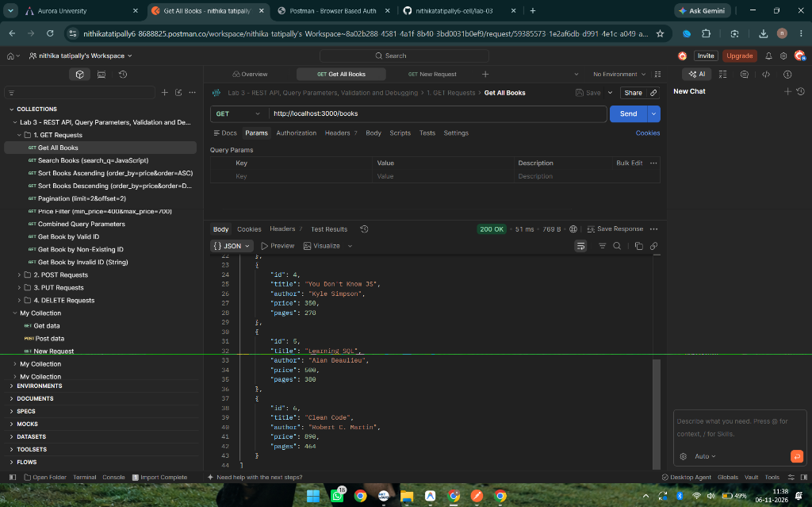

### 2. GET Books with Partial Title Search (`search_q`)
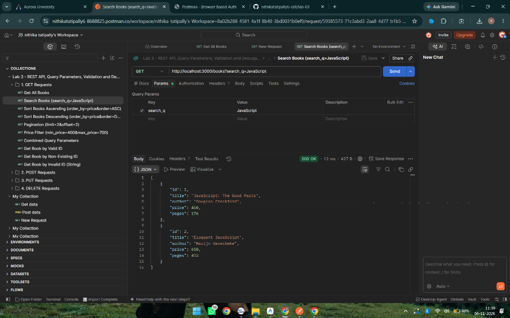

### 3. GET Books Sorted Ascending (`order_by=price&order=ASC`)
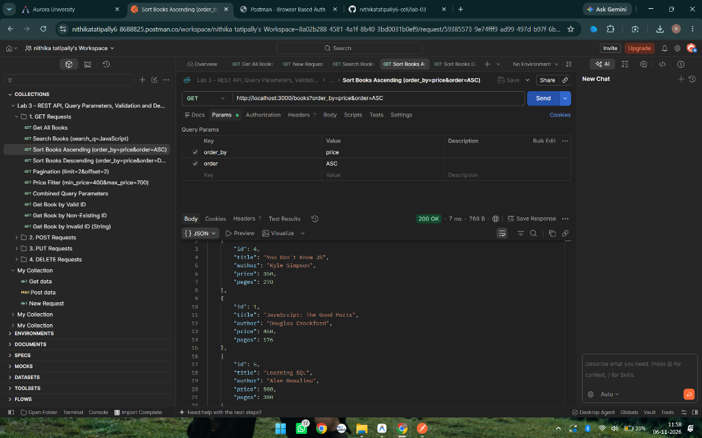

### 4. GET Books Sorted Descending (`order_by=price&order=DESC`)
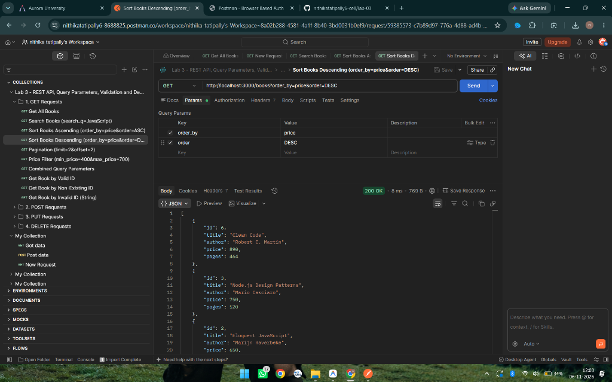

### 5. GET Books with Pagination (`limit=2&offset=2`)
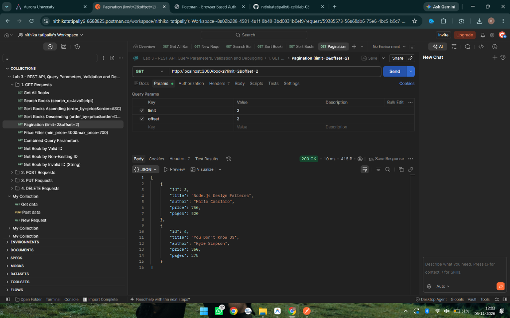

### 6. GET Books with Price Range Filtering (`min_price` & `max_price`)


### 7. GET Books Combined Query Parameters
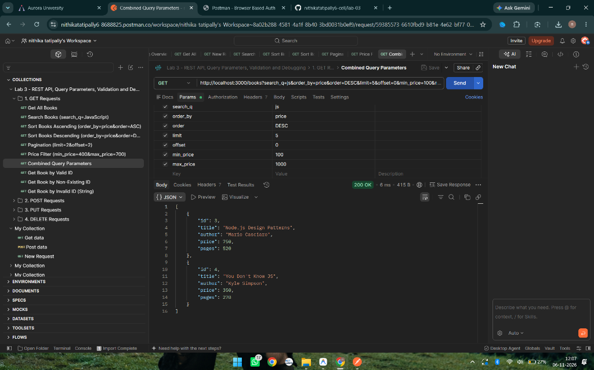

### 8. GET Single Book by ID (HTTP 200)
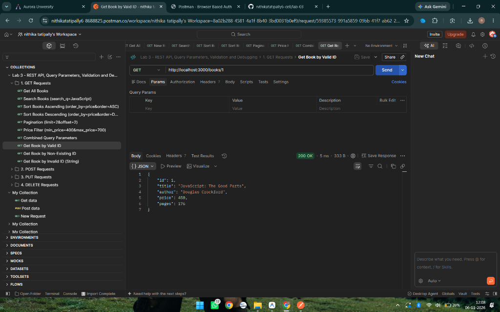

### 9. GET Single Book - Not Found (HTTP 404)
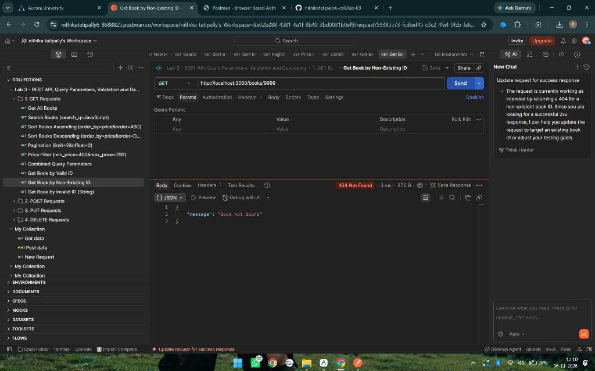

### 10. GET Single Book - Invalid ID (HTTP 400)
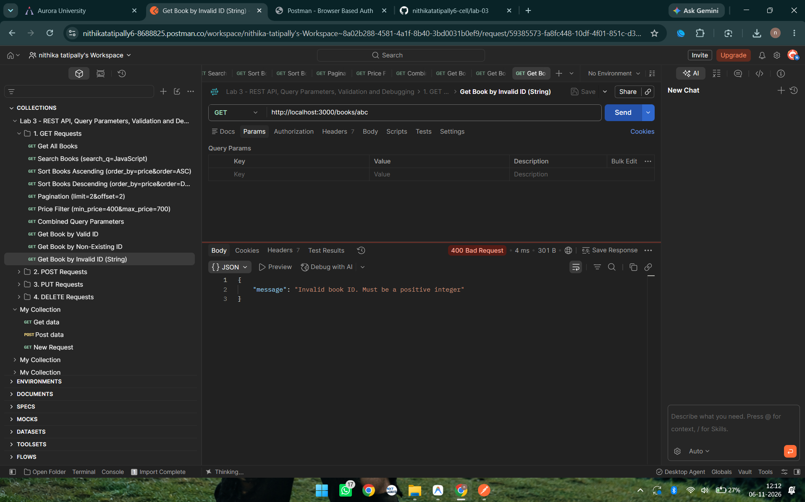

### 11. POST Create New Book (HTTP 201)
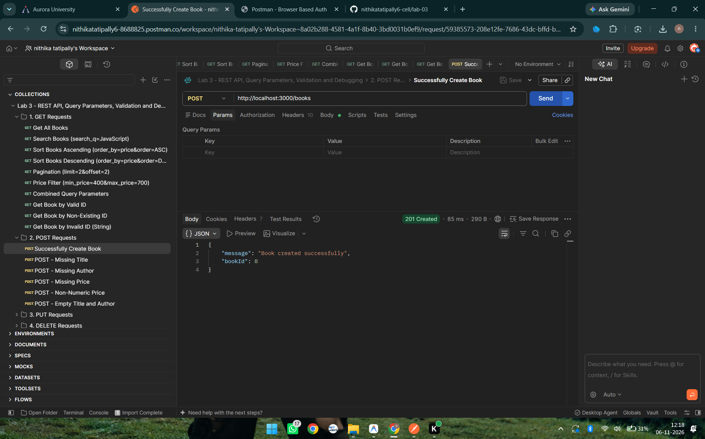

### 12. POST Validation Failure (HTTP 400)
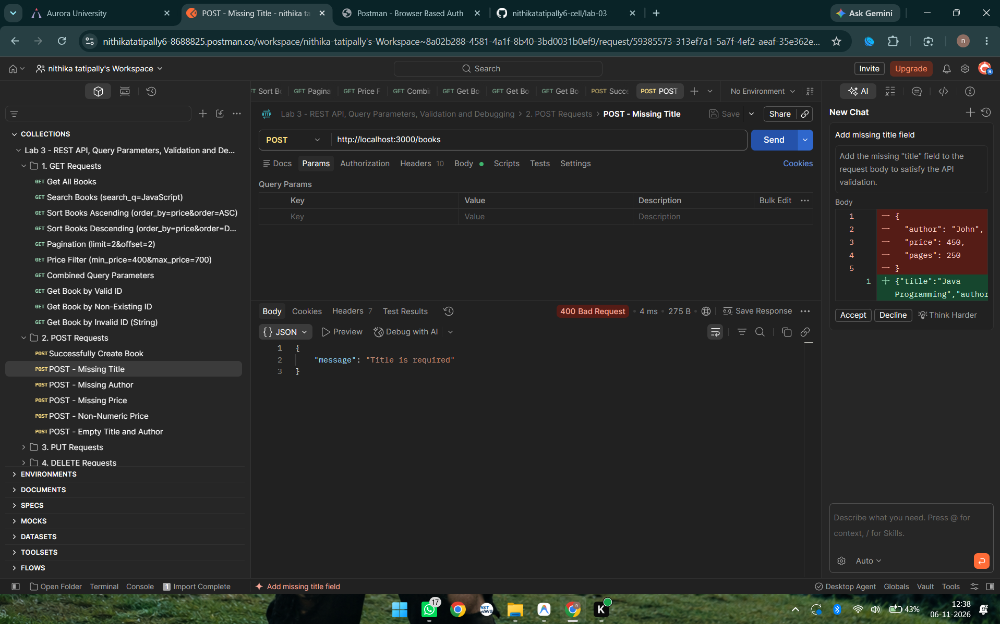

### 13. PUT Update Existing Book (HTTP 200)
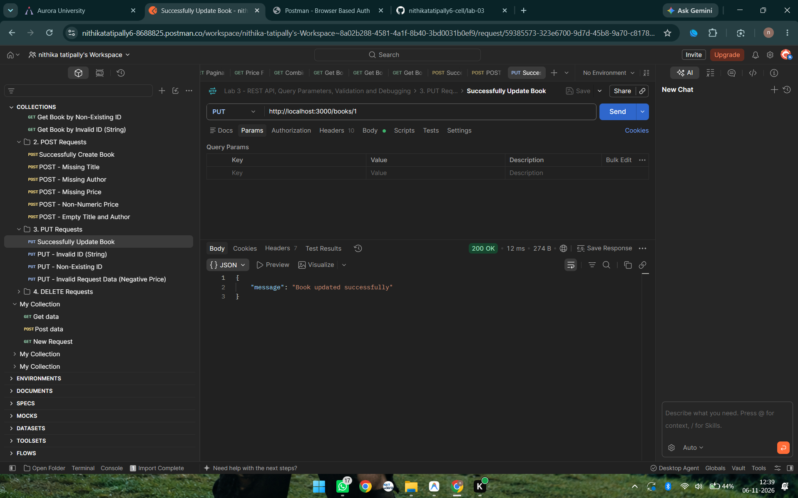

### 14. PUT Book Not Found (HTTP 404)
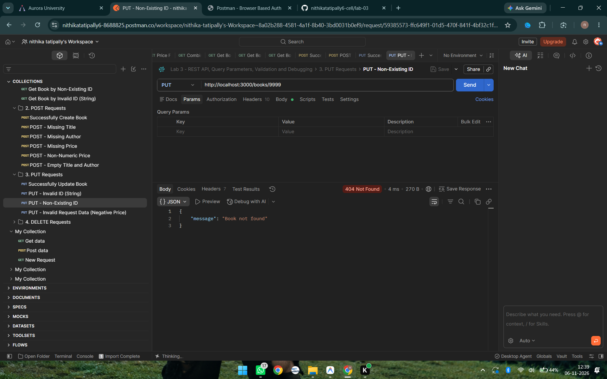

### 15. DELETE Book Success (HTTP 200)
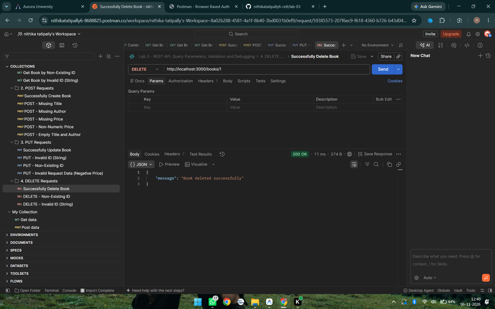

### 16. DELETE Book Not Found (HTTP 404)
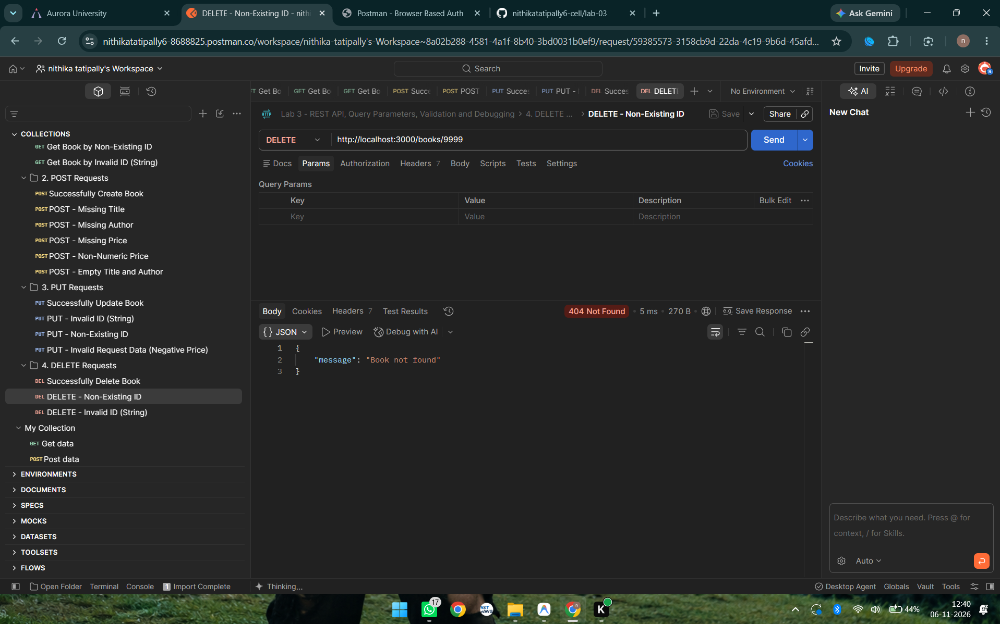

---

## 12. Problems Faced and Solutions

1. **SQL Injection Vulnerability in ORDER BY clauses:**
   - *Challenge:* SQLite parameter binding (`?`) works exclusively for literal values, not SQL keywords (`ASC`, `DESC`) or column identifiers (`price`, `title`).
   - *Resolution:* Implemented a strict whitelist check for both `order_by` and `order` parameters. If any unapproved value is submitted, the API rejects the request with HTTP 400, preventing SQL injection vulnerabilities.

2. **Accidental Duplicate Database Seeding:**
   - *Challenge:* Restarting the server repeatedly during development could re-insert initial sample books each time.
   - *Resolution:* Added a pre-insertion count query (`SELECT COUNT(*) AS count FROM book`). Seeding only triggers if the table is completely empty (`count === 0`).

3. **Loose Type Handling in Express Query Parameters:**
   - *Challenge:* Express query parameters always arrive as strings (`req.query.limit = "5"`). Unvalidated string input can cause incorrect SQL slicing or unexpected behavior.
   - *Resolution:* Applied explicit numeric parsing and sanity verification (`parseInt`, `Number.isInteger`, non-negativity checks) with descriptive error messages.

---

## 13. Git & GitHub Preparation

### Recommended Commands to Track and Commit Lab 3

From the root of your course repository:

```bash
# 1. Check current status
git status

# 2. Stage only the lab-03 folder (leaves other lab folders untouched)
git add lab-03/

# 3. Commit changes with a descriptive message
git commit -m "feat(lab-03): implement REST API with query parameters, validation, and debugging"

# 4. Push to your remote repository (when ready and authorized)
git push origin main
```

---

## 14. Deployment / Live URL

- **Deployment Status:** `Not Deployed (Local Lab Environment)`
- **Live URL Placeholder:** `https://[your-deployment-url-here]`

## Live Demo

The application is deployed and can be accessed at: https://lab-3-mbsw.onrender.com
